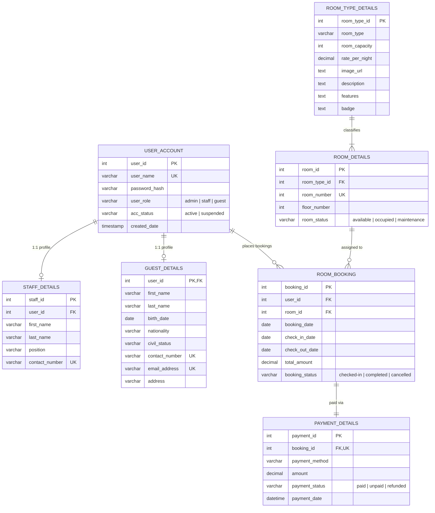

# Burgundy Suite & Resort — Complete System Architecture & Technical Documentation

---

## 1. Executive Summary

**Burgundy Suite & Resort** is an enterprise-grade luxury hospitality web platform and property management system (PMS). It delivers an opulent, interactive guest booking experience paired with an executive command center for resort administrators, general managers, and front-desk concierge staff.

The system is engineered as a decoupled modern **Monorepo** deploying as a unified **Vercel Multi-Services Project**:
1. **Frontend**: **Nuxt 3 (Vue 3 Single File Components)** powered by Vite, Tailwind CSS v4, Lucide icons, and reactive composables (`http://localhost:3000`).
2. **Backend**: **Nest.js 10** enterprise REST API (`http://localhost:4000/api`) structured with modular TypeScript architecture, dependency injection, controllers, guards, and services.
3. **Database & Storage**: Dual-persistence engine featuring live edge **Cloudflare D1 (Serverless SQLite)** via REST API, **Cloudflare R2 (Object Storage)** via S3 protocol, and a zero-config local JSON persistence store fallback (`data/burgundy_store.json`).
4. **Deployment**: Native **Vercel Services** architecture deploying both frontend and backend under a single domain with top-level URL rewrites and inter-service bindings.

---

## 2. Technology Stack

| Layer | Technology | Purpose & Implementation Details |
| :--- | :--- | :--- |
| **Frontend Framework** | **Nuxt 3.21 / Vue 3.5** | Reactive component model, Nitro server engine, dynamic route SSR/SPA rendering, and composables (`useAuth`, `useApi`). |
| **Frontend Tooling** | **Vite 7 & TypeScript 5** | Instant hot-module replacement (HMR), tree-shaking, and type validation across all templates. |
| **Styling & Design System** | **Tailwind CSS v4** | Curated luxury color tokens: Deep Burgundy (`#2B0E14`), Rich Wine (`#741B2D`), Warm Gold (`#D4AF37` / `#E5C378`), and Cream Ivory (`#F5EFEB`). |
| **Backend Framework** | **Nest.js 10** | Enterprise TypeScript framework utilizing modular separation of concerns (`AuthModule`, `RoomsModule`, `BookingsModule`, `AdminModule`, `CloudflareModule`, `MediaModule`). |
| **Relational Database** | **Cloudflare D1 (SQLite)** | Serverless edge SQL database strictly modeled to a 7-table normalized ERD schema with parameterized queries and batch transactions. |
| **Object Storage** | **Cloudflare R2** | S3-compatible, zero-egress bucket storage for high-resolution suite photography and staff account snapshots via `@aws-sdk/client-s3`. |
| **Persistence Fallback** | **Local JSON Store** | `data/burgundy_store.json` provides seamless local development and offline persistence if Cloudflare credentials are unset. |
| **Authentication & Sessions** | **HMAC Signed Cookies** | Secure HTTP-only session cookies with SHA-256 HMAC signatures, password hashing, and Cloudflare Zero Trust / Access header support. |
| **Deployment Engine** | **Vercel Multi-Services** | Monorepo deployment with top-level rewrites (`/api/*` -> `backend`, `/*` -> `frontend`) and internal service bindings (`BACKEND_URL`). |

---

## 3. High-Level Monorepo Architecture

```mermaid
graph TD
    subgraph Edge ["Public Edge / Vercel Ingress Router"]
        VercelRouter["Vercel Edge Router<br/>(Single Domain)"]
    end

    subgraph FrontendService ["Frontend Service (Nuxt 3 — Port 3000)"]
        GuestView["Guest Luxury Portal (/)<br/>• Suite Showcase & Bento Bento<br/>• Multi-Step Reservation Modal<br/>• Passwordless Stay Verification"]
        AdminView["Admin Command Center (/admin)<br/>• Real-time Occupancy & KPIs<br/>• 7-Day Performance Chart<br/>• Floor Inventory Grid<br/>• Staff Accounts & Provisioning<br/>• Add Suite Modal (Live Preview)"]
        NitroProxy["Nitro Server Handler (/server/api/[...].ts)"]
    end

    subgraph BackendService ["Backend Service (Nest.js — Port 4000)"]
        NestGateway["NestJS API Gateway (/api)"]
        AuthMod["AuthModule (/api/auth)"]
        RoomsMod["RoomsModule (/api/rooms, /api/room-types)"]
        BookingsMod["BookingsModule (/api/bookings)"]
        AdminMod["AdminModule (/api/admin)"]
        CloudflareMod["CloudflareModule (/api/cloudflare)"]
        MediaMod["MediaModule (/api/upload, /api/media)"]
        DbService["DatabaseService Engine"]
    end

    subgraph Persistence ["Persistence & Storage Layer"]
        D1[("Cloudflare D1 Database<br/>(Serverless SQLite Edge)")]
        R2[("Cloudflare R2 Bucket<br/>(Media & Image Storage)")]
        LocalDb[("Local Store Fallback<br/>(data/burgundy_store.json)")]
    end

    VercelRouter -->|/api/*| NestGateway
    VercelRouter -->|/*| GuestView
    VercelRouter -->|/admin*| AdminView
    NitroProxy -.->|Internal Service Binding (BACKEND_URL)| NestGateway

    NestGateway --> AuthMod
    NestGateway --> RoomsMod
    NestGateway --> BookingsMod
    NestGateway --> AdminMod
    NestGateway --> CloudflareMod
    NestGateway --> MediaMod
    NestGateway --> DbService

    DbService -->|Cloudflare REST API| D1
    DbService -->|Local File I/O| LocalDb
    MediaMod -->|S3 Protocol| R2
```

---

## 4. Vercel Multi-Services Configuration

The project utilizes Vercel's multi-service architecture defined in [vercel.json](file:///c:/Users/Ian/OneDrive/Desktop/cha/burgundysuite/vercel.json) at the repository root. This allows both the Nuxt 3 frontend and the NestJS backend to exist in the same repository, deploy to the same domain, and communicate privately.

### Configuration Schema (`vercel.json`)
```json
{
  "$schema": "https://openapi.vercel.sh/vercel.json",
  "services": {
    "backend": {
      "root": "backend",
      "framework": "nestjs"
    },
    "frontend": {
      "root": "frontend",
      "framework": "nuxtjs",
      "bindings": [
        {
          "type": "service",
          "service": "backend",
          "format": "url",
          "env": "BACKEND_URL"
        }
      ]
    }
  },
  "rewrites": [
    {
      "source": "/api/(.*)",
      "destination": {
        "service": "backend"
      }
    },
    {
      "source": "/(.*)",
      "destination": {
        "service": "frontend"
      }
    }
  ]
}
```

### Architectural Principles:
1. **Public Routing**:
   - `/api/(.*)` routes directly to the **`backend`** service. Because NestJS sets `app.setGlobalPrefix('api')`, all controller endpoints match the incoming paths natively.
   - `/(.*)` routes to the **`frontend`** service, serving the Nuxt 3 public pages, static assets, and administration dashboard.
2. **Internal Service Binding**:
   - The `frontend` service declares a binding targeting `backend`.
   - Vercel automatically injects the internal private URL into the environment variable **`BACKEND_URL`** at runtime.
   - [frontend/server/api/[...].ts](file:///c:/Users/Ian/OneDrive/Desktop/cha/burgundysuite/frontend/server/api/[...].ts) consumes `process.env.BACKEND_URL` to securely proxy server-side calls without exposing internal networking details.

---

## 5. Repository Structure

```
burgundysuite/
├── vercel.json                    # Vercel Multi-Service topology and rewrite routing
├── package.json                   # Monorepo orchestration (concurrent dev, builds, D1 scripts)
├── tsconfig.json                  # Root TypeScript configuration
├── .gitignore                     # Monorepo exclusions (.nuxt, dist, node_modules, uploads)
├── .env.example                   # Environment configuration template
│
├── backend/                       # Nest.js Enterprise REST API (Port 4000)
│   ├── nest-cli.json              # Nest CLI configuration
│   ├── package.json               # Backend dependencies (NestJS, @aws-sdk/client-s3, cookie-parser)
│   ├── tsconfig.json              # Backend TypeScript settings
│   └── src/
│       ├── main.ts                # Bootstrap: Global '/api' prefix, Dynamic CORS, CookieParser
│       ├── app.module.ts          # Root module assembling submodules & database
│       ├── types/
│       │   └── database.ts        # Canonical TypeScript models for 7-table ERD
│       ├── database/
│       │   ├── database.module.ts # Global database provider
│       │   └── database.service.ts# Relational DBMS engine, D1 query executor & local JSON mirror
│       └── modules/
│           ├── auth/              # HMAC sessions, login, logout, me, Turnstile validation
│           ├── rooms/             # Physical room inventory & suite tier controllers
│           ├── bookings/          # Reservation creation, newest-first ledger, checkout
│           ├── admin/             # Aggregate KPIs, staff accounts CRUD, payments, reset
│           ├── cloudflare/        # D1 query execution, telemetry probe, and 1-click sync
│           └── media/             # Cloudflare R2 multipart upload & media streaming proxy
│
├── frontend/                      # Nuxt 3 Luxury Web Application (Port 3000)
│   ├── nuxt.config.ts             # Tailwind v4 Vite plugin, Google Fonts, Nitro proxy
│   ├── package.json               # Frontend dependencies (Nuxt, Vue 3, Lucide, Tailwind)
│   ├── tsconfig.json              # Frontend TypeScript config
│   ├── app.vue                    # Root Nuxt layout container
│   ├── assets/
│   │   └── css/main.css           # Luxury burgundy design system, typography & animations
│   ├── composables/
│   │   ├── useApi.ts              # Fetch client handling credentials and cookies
│   │   └── useAuth.ts             # Reactive admin session management state
│   ├── server/
│   │   └── api/
│   │       └── [...].ts           # Nitro server proxy consuming bound BACKEND_URL
│   ├── pages/
│   │   ├── index.vue              # Public Guest Portal
│   │   └── admin/
│   │       └── index.vue          # Executive Administration Command Center
│   └── components/
│       ├── Navbar.vue             # Header navigation with guest verification button
│       ├── Hero.vue               # Visual banner with instant availability date picker
│       ├── HavenOverview.vue      # Bento grid showcasing resort amenities & philosophy
│       ├── SuitesSection.vue      # Curated suite cards with pagination & booking trigger
│       ├── ReservationModal.vue   # Multi-step booking modal with real-time bill breakdown
│       ├── VerifyBookingModal.vue # Passwordless guest email stay lookup & live status
│       ├── AmenitiesSection.vue   # Comprehensive amenities list & VIP resort perks
│       ├── Footer.vue             # Opulent footer with concierge contact details
│       └── admin/
│           ├── AdminLoginGate.vue # Credentials gate for management staff
│           ├── AdminHeader.vue    # Executive toolbar with actions & user profile
│           ├── AdminHeroBanner.vue# Luxury header banner with smooth scroll cues
│           ├── AdminKPIs.vue      # Revenue, Occupancy %, Room counts, Today's departures
│           ├── AdminChart.vue     # Dynamic 7-day revenue performance trend visualizer
│           ├── RoomInventoryGrid.vue # Floor cards with live status toggle
│           ├── BookingsTable.vue  # Newest-first booking ledger with 1-click checkout
│           ├── PaymentLogs.vue    # Financial audit trail linked to booking IDs
│           ├── StaffAccountsModal.vue # Staff directory & account provisioning modal
│           ├── AddSuiteModal.vue  # Large live guest preview card & R2 drag-and-drop
│           ├── CloudflareD1Modal.vue  # Live D1 connectivity telemetry & 1-click sync
│           └── ConfirmModal.vue   # Accessible confirmation modal
│
├── data/
│   └── burgundy_store.json        # Zero-config local JSON persistence database
└── migrations/
    ├── 0001_initial_schema.sql    # 7-table DDL schema for Cloudflare D1
    └── seed.sql                   # Initial production seed data
```

---

## 6. Relational Database Specification (7-Table ERD)

The database schema strictly models a luxury hotel operation across 7 normalized tables:



### Table Definitions & Constraints

1. **`USER_ACCOUNT`**:
   - `user_id` (INTEGER, Primary Key, Auto Increment)
   - `user_name` (VARCHAR, Unique, Not Null)
   - `password_hash` (VARCHAR, Not Null)
   - `user_role` (VARCHAR, Enum: `'admin' | 'staff' | 'guest'`)
   - `acc_status` (VARCHAR, Enum: `'active' | 'suspended'`, Default: `'active'`)
   - `created_date` (DATETIME, Default: Current Timestamp)

2. **`STAFF_DETAILS`**:
   - `staff_id` (INTEGER, Primary Key, Auto Increment)
   - `user_id` (INTEGER, Foreign Key referencing `USER_ACCOUNT(user_id)` ON DELETE CASCADE)
   - `first_name` (VARCHAR, Not Null)
   - `last_name` (VARCHAR, Not Null)
   - `position` (VARCHAR, e.g., `'General Manager'`, `'Executive Concierge'`)
   - `contact_number` (VARCHAR, Unique, Not Null)

3. **`GUEST_DETAILS`**:
   - `user_id` (INTEGER, Primary Key, Foreign Key referencing `USER_ACCOUNT(user_id)` ON DELETE CASCADE)
   - `first_name`, `last_name` (VARCHAR, Not Null)
   - `birth_date` (DATE)
   - `nationality`, `civil_status` (VARCHAR)
   - `contact_number` (VARCHAR, Unique)
   - `email_address` (VARCHAR, Unique, Not Null)
   - `address` (TEXT)

4. **`ROOM_TYPE_DETAILS`**:
   - `room_type_id` (INTEGER, Primary Key, Auto Increment)
   - `room_type` (VARCHAR, Not Null)
   - `room_capacity` (INTEGER, Not Null, Min: 1)
   - `rate_per_night` (DECIMAL, Not Null)
   - `image_url` (TEXT)
   - `description` (TEXT)
   - `features` (TEXT / JSON array of bullet points)
   - `badge` (VARCHAR, e.g., `'Up to 2 Guests'`, `'VIP Presidential'`)

5. **`ROOM_DETAILS`**:
   - `room_id` (INTEGER, Primary Key, Auto Increment)
   - `room_type_id` (INTEGER, Foreign Key referencing `ROOM_TYPE_DETAILS(room_type_id)`)
   - `room_number` (INTEGER, Unique, Not Null, e.g., `101`, `201`)
   - `floor_number` (INTEGER, Not Null, e.g., `1` through `5`)
   - `room_status` (VARCHAR, Enum: `'available' | 'occupied' | 'maintenance'`)

6. **`ROOM_BOOKING`**:
   - `booking_id` (INTEGER, Primary Key, Auto Increment)
   - `user_id` (INTEGER, Foreign Key referencing `USER_ACCOUNT(user_id)`)
   - `room_id` (INTEGER, Foreign Key referencing `ROOM_DETAILS(room_id)`)
   - `booking_date` (DATE, Not Null)
   - `check_in_date` (DATE, Not Null)
   - `check_out_date` (DATE, Not Null)
   - `total_amount` (DECIMAL, Not Null)
   - `booking_status` (VARCHAR, Enum: `'checked-in' | 'completed' | 'cancelled'`)

7. **`PAYMENT_DETAILS`**:
   - `payment_id` (INTEGER, Primary Key, Auto Increment)
   - `booking_id` (INTEGER, Unique, Foreign Key referencing `ROOM_BOOKING(booking_id)`)
   - `payment_method` (VARCHAR, e.g., `'GCash'`, `'Maya'`, `'Credit Card'`, `'Bank Transfer'`)
   - `amount` (DECIMAL, Not Null)
   - `payment_status` (VARCHAR, Enum: `'paid' | 'unpaid' | 'refunded'`, Default: `'paid'`)
   - `payment_date` (DATETIME, Default: Current Timestamp)

---

## 7. Business Logic & Chronology Rules

### 1. Newest-First Booking Ordering
In all guest and administrative interfaces, bookings are sorted **descending by `booking_id`**:
- **Backend**: In [database.service.ts](file:///c:/Users/Ian/OneDrive/Desktop/cha/burgundysuite/backend/src/database/database.service.ts), `getBookings()` and `getBookingsByEmail()` explicitly execute:
  ```ts
  db.ROOM_BOOKING.slice().sort((a, b) => b.booking_id - a.booking_id)
  ```
- **Admin Controller**: In `getPayments()`, transaction records sort descending by `payment_id`.
- **Frontend Tables**: [BookingsTable.vue](file:///c:/Users/Ian/OneDrive/Desktop/cha/burgundysuite/frontend/components/admin/BookingsTable.vue), [PaymentLogs.vue](file:///c:/Users/Ian/OneDrive/Desktop/cha/burgundysuite/frontend/components/admin/PaymentLogs.vue), and [VerifyBookingModal.vue](file:///c:/Users/Ian/OneDrive/Desktop/cha/burgundysuite/frontend/components/VerifyBookingModal.vue) guarantee that the most recent reservation always sits at row #1.

### 2. Physical Room Allocation & Availability Checking

#### A. Dedicated Availability Check (Non-Reserving)
- When guests click **"Check Availability"** on the hero search bar, the platform queries `GET /api/rooms/availability?checkIn=&checkOut=&roomTypeId=`.
- The system evaluates physical room assignments against active bookings (`check_in_date < targetOut && check_out_date > targetIn`) and maintenance locks.
- Displays an interactive **Availability Modal** (`AvailabilityModal.vue`) showing:
  - Total available vs. occupied suites for the selected dates.
  - Nightly rate and calculated stay total (number of nights).
  - Room status badges: 🟢 **Available (X Suites Ready)** vs. 🔴 **Occupied for Selected Dates**.
  - **No reservation is created or personal guest details requested** during an availability check.
  - If a guest decides to proceed, clicking **"Book This Suite"** transfers their selected suite and dates to the reservation workflow.

#### B. Reservation Booking & Allocation
When a guest initiates a reservation:
1. The system locates an available room of the requested suite category (`room_status === 'available'`).
2. If all rooms of that type are occupied, the booking engine allocates the primary suite room while updating its occupancy.
3. Upon booking submission, the allocated room's status flips to `'occupied'` and the guest account is created/updated.
4. When an administrator triggers **Check Out**:
   - `ROOM_BOOKING.booking_status` updates to `'completed'`.
   - The associated `ROOM_DETAILS.room_status` transitions back to `'available'`.
   - Aggregate metrics (Occupancy %, Available count) re-compute instantly.

### 3. Dual Storage Synchronization
- When `CLOUDFLARE_D1_DATABASE_ID` and `CLOUDFLARE_API_TOKEN` are provided in the environment, all state changes (new suites, room status changes, bookings, staff accounts) execute parameterized SQL queries against Cloudflare D1's REST API.
- If Cloudflare is unreachable or credentials are not yet configured, the system seamlessly uses `data/burgundy_store.json`, ensuring 100% functionality in offline and local development environments.
- Administrators can click **1-Click Sync to Cloudflare D1** in `/admin` at any time to push the full schema and seed data to Cloudflare.

---

## 8. Backend REST API Specification

Base Path: `/api`

### Authentication (`/api/auth`)
| Method | Endpoint | Description | Request Body | Response |
| :--- | :--- | :--- | :--- | :--- |
| `POST` | `/api/auth/login` | Authenticate admin/staff user and set HTTP-only cookie | `{ username, password }` | `{ success: true, user: { user_id, user_name, user_role, name } }` |
| `POST` | `/api/auth/logout`| Invalidate session and clear cookie | None | `{ success: true, message: "Logged out" }` |
| `GET` | `/api/auth/me` | Return active session user | None (reads cookie / CF Access) | `{ success: true, user: { ... } }` |

### Rooms & Inventory (`/api/rooms`, `/api/room-types`)
| Method | Endpoint | Description | Request Body / Query | Response |
| :--- | :--- | :--- | :--- | :--- |
| `GET` | `/api/rooms/availability` | Real-time check of room availability across date ranges without reserving | Query: `?checkIn=&checkOut=&roomTypeId=` | `{ success: true, data: RoomAvailabilityResponse }` |
| `GET` | `/api/rooms` | Retrieve all physical rooms with joined category data | None | `{ success: true, data: RoomWithDetails[] }` |
| `PATCH`| `/api/rooms` | Update physical room status | `{ room_id: number, status: 'available' \| 'occupied' \| 'maintenance' }` | `{ success: true, data: RoomWithDetails }` |
| `GET` | `/api/room-types` | Retrieve all suite categories | None | `{ success: true, data: RoomTypeDetails[] }` |
| `POST` | `/api/room-types` | Provision a new suite tier and physical room | `{ room_type, rate_per_night, room_capacity, description, image_url, features[] }` | `{ success: true, data: { roomType, room } }` |

### Bookings & Reservations (`/api/bookings`)
| Method | Endpoint | Description | Request Body / Query | Response |
| :--- | :--- | :--- | :--- | :--- |
| `GET` | `/api/bookings` | List all bookings sorted newest-first | Optional query: `?email=` | `{ success: true, data: BookingWithDetails[] }` |
| `POST` | `/api/bookings` | Create a new reservation, guest, and payment | `{ room_type_id, check_in_date, check_out_date, first_name, last_name, email_address, contact_number, payment_method, address, birth_date, nationality, civil_status }` | `{ success: true, message: string, data: BookingWithDetails }` |
| `POST` | `/api/bookings/:id/checkout` | Process departure check-out and free the room | URL param: `:id` | `{ success: true, message: string, data: BookingWithDetails }` |

### Administration & Metrics (`/api/admin`)
| Method | Endpoint | Description | Request Body / Query | Response |
| :--- | :--- | :--- | :--- | :--- |
| `GET` | `/api/admin/metrics` | Retrieve financial and occupancy KPIs | None | `{ success: true, data: { total_revenue, weekly_revenue_delta, occupancy_rate_percent, occupied_rooms_count, total_rooms_count, pending_checkouts_today_count, weekly_performance_chart[] } }` |
| `GET` | `/api/admin/accounts`| List staff directory accounts | Admin cookie required | `{ success: true, data: StaffAccount[] }` |
| `POST` | `/api/admin/accounts`| Provision a new staff account | `{ user_name, password, user_role, first_name, last_name, position, contact_number }` | `{ success: true, message: string, data: StaffAccount }` |
| `PUT` | `/api/admin/accounts`| Edit an existing staff profile | `{ user_id, first_name, last_name, position, contact_number, password? }` | `{ success: true, data: StaffAccount }` |
| `DELETE`| `/api/admin/accounts`| Terminate staff account (with self-delete guard)| Query: `?id=number` | `{ success: true, message: string }` |
| `GET` | `/api/payments` | Retrieve payment ledger logs | None | `{ success: true, data: PaymentDetails[] }` |
| `POST` | `/api/admin/simulate-checkout` | Run automated departures for stays ending today | None | `{ success: true, checked_out_count: number }` |
| `POST` | `/api/admin/reset` | Restore database to initial clean seed state | None | `{ success: true, message: string }` |

### Cloudflare Edge & Media (`/api/cloudflare`, `/api/upload`)
| Method | Endpoint | Description | Request Body | Response |
| :--- | :--- | :--- | :--- | :--- |
| `GET` | `/api/cloudflare` | Probe D1 database and R2 bucket connectivity | None | `{ success: true, data: { configured, connected, d1_status, r2_status, latency_ms } }` |
| `POST` | `/api/cloudflare` | Update Cloudflare credentials dynamically | `{ account_id, database_id, api_token, r2_bucket_name, r2_access_key_id, r2_secret_access_key }` | `{ success: true, message: string }` |
| `POST` | `/api/cloudflare/sync` | Execute D1 schema & seed migration remotely | None | `{ success: true, message: string }` |
| `POST` | `/api/upload` | Upload image to Cloudflare R2 bucket | `multipart/form-data` with `file` & `folder` | `{ success: true, data: { key, url, size } }` |
| `GET` | `/api/media/*` | Serve image binary from R2 or local cache | Wildcard key | Binary image stream |

---

## 9. Frontend Architecture & Components

The frontend is a Nuxt 3 application with Tailwind CSS v4 styling, structured around two main entry pages:

### 1. Guest Luxury Portal (`frontend/pages/index.vue`)
- **[Navbar.vue](file:///c:/Users/Ian/OneDrive/Desktop/cha/burgundysuite/frontend/components/Navbar.vue)**: Transparent-to-frosted glass header with branding, anchor navigation links, and a **Verify My Booking** action modal trigger.
- **[Hero.vue](file:///c:/Users/Ian/OneDrive/Desktop/cha/burgundysuite/frontend/components/Hero.vue)**: Fullscreen video/image backdrop with headline typography, promotional taglines, and an interactive availability date selector.
- **[HavenOverview.vue](file:///c:/Users/Ian/OneDrive/Desktop/cha/burgundysuite/frontend/components/HavenOverview.vue)**: Bento-box masonry grid presenting architectural highlights, private culinary experiences, and beachfront privileges.
- **[SuitesSection.vue](file:///c:/Users/Ian/OneDrive/Desktop/cha/burgundysuite/frontend/components/SuitesSection.vue)**: Responsive showcase of available room types with pagination controls, guest capacity pills, nightly rates, amenity bullets, and direct booking CTA buttons.
- **[ReservationModal.vue](file:///c:/Users/Ian/OneDrive/Desktop/cha/burgundysuite/frontend/components/ReservationModal.vue)**: 3-step modal capturing dates, guest personal details, and payment selection with real-time VAT & fee calculation.
- **[VerifyBookingModal.vue](file:///c:/Users/Ian/OneDrive/Desktop/cha/burgundysuite/frontend/components/VerifyBookingModal.vue)**: Passwordless verification interface allowing guests to look up their reservations using their registered email address.

### 2. Executive Command Center (`frontend/pages/admin/index.vue`)
- **[AdminLoginGate.vue](file:///c:/Users/Ian/OneDrive/Desktop/cha/burgundysuite/frontend/components/admin/AdminLoginGate.vue)**: Glassmorphic authentication portal supporting credential login (`admin` / `admin123` or provisioned staff accounts) with instant session establishment.
- **[AdminHeader.vue](file:///c:/Users/Ian/OneDrive/Desktop/cha/burgundysuite/frontend/components/admin/AdminHeader.vue)**: Top bar with session status, Cloudflare D1 modal launcher, staff account directory button, and sign-out handler.
- **[AdminKPIs.vue](file:///c:/Users/Ian/OneDrive/Desktop/cha/burgundysuite/frontend/components/admin/AdminKPIs.vue)**: Live metrics cards displaying Gross Revenue, Occupancy Percentage, Available vs. Occupied rooms, and Pending Checkouts today.
- **[AdminChart.vue](file:///c:/Users/Ian/OneDrive/Desktop/cha/burgundysuite/frontend/components/admin/AdminChart.vue)**: Dynamic 7-day revenue visualization showing financial volume over time.
- **[RoomInventoryGrid.vue](file:///c:/Users/Ian/OneDrive/Desktop/cha/burgundysuite/frontend/components/admin/RoomInventoryGrid.vue)**: Floor-by-floor room grid allowing staff to toggle room statuses (`Available`, `Occupied`, `Maintenance`) with 1-click live updates.
- **[BookingsTable.vue](file:///c:/Users/Ian/OneDrive/Desktop/cha/burgundysuite/frontend/components/admin/BookingsTable.vue)**: Searchable, filterable booking roster sorted chronologically (newest first) with 1-click guest departure checkout.
- **[PaymentLogs.vue](file:///c:/Users/Ian/OneDrive/Desktop/cha/burgundysuite/frontend/components/admin/PaymentLogs.vue)**: Financial transaction audit log showing payment method, date, status, and corresponding booking ID.
- **[AddSuiteModal.vue](file:///c:/Users/Ian/OneDrive/Desktop/cha/burgundysuite/frontend/components/admin/AddSuiteModal.vue)**:
  - Compressed dialog architecture (`max-h-[92vh]`) that prevents viewport clipping.
  - Form wrapping both inputs and footer with robust submit handling.
  - **Enlarged Live Guest View Preview Card** (`w-full max-w-[340px]`, `aspect-[4/3]`) displaying instant updates as the administrator types room name, price, capacity, and amenities.
  - Integrated Cloudflare R2 image upload dropzone with fallback Unsplash preset gallery.

---

## 10. Environment Variables Reference

Create `.env.local` at the project root based on [.env.example](file:///c:/Users/Ian/OneDrive/Desktop/cha/burgundysuite/.env.example):

```bash
# ==============================================================================
# SERVER & LOCAL PORTS
# ==============================================================================
PORT=4000
BACKEND_URL=http://127.0.0.1:4000
NUXT_PUBLIC_API_BASE=http://localhost:4000

# ==============================================================================
# CLOUDFLARE D1 (Serverless SQLite Relational Database)
# ==============================================================================
CLOUDFLARE_ACCOUNT_ID=your_cloudflare_account_id_here
CLOUDFLARE_D1_DATABASE_ID=your_d1_database_uuid_here
CLOUDFLARE_API_TOKEN=your_cloudflare_api_token_here

# ==============================================================================
# CLOUDFLARE R2 (S3-Compatible Object Storage)
# ==============================================================================
CLOUDFLARE_R2_ACCESS_KEY_ID=your_r2_access_key_id_here
CLOUDFLARE_R2_SECRET_ACCESS_KEY=your_r2_secret_access_key_here
CLOUDFLARE_R2_BUCKET_NAME=burgundy-bucket
CLOUDFLARE_R2_PUBLIC_DOMAIN=https://pub-yourdomain.r2.dev

# ==============================================================================
# SECURITY & AUTHENTICATION
# ==============================================================================
AUTH_SECRET=burgundy_resort_secure_hmac_secret_key_2026_super_private
```

---

## 11. Local Development & Operational Commands

### 1. Install Monorepo Dependencies
```bash
npm install
npm --prefix backend install
npm --prefix frontend install
```

### 2. Run Locally in Parallel
```bash
npm run dev
```
- **Nuxt 3 Frontend**: [http://localhost:3000](http://localhost:3000)
- **Nest.js API**: [http://localhost:4000/api](http://localhost:4000/api)

### 3. Run Services Separately
```bash
# Terminal 1: Nest.js Backend
npm run dev:backend

# Terminal 2: Nuxt 3 Frontend
npm run dev:frontend
```

### 4. Production Build Validation
```bash
npm run build
```
- Validates and compiles the NestJS backend into `backend/dist`.
- Compiles the Nuxt 3 application and Nitro server into `frontend/.output`.

### 5. Type Checking
```bash
npm run typecheck
```

### 6. Cloudflare D1 Remote Migration (CLI)
```bash
# Execute initial schema migration remotely on Cloudflare D1
npm run d1:migrate

# Seed remote Cloudflare D1 database
npm run d1:seed
```

---

## 12. Troubleshooting & FAQ

#### Q: How do I deploy to Vercel?
**A**: Ensure your repository root has [vercel.json](file:///c:/Users/Ian/OneDrive/Desktop/cha/burgundysuite/vercel.json) (already configured). When importing the project in Vercel:
- In Vercel Project Settings > General, set **Root Directory** to `.` (the repository root).
- Vercel automatically detects the multi-service topology, building the `backend` and `frontend` services independently and wiring the inter-service bindings.
- Add your environment variables (from `.env.example`) to the Vercel dashboard.

#### Q: How do I test with default admin credentials?
**A**: Navigate to `http://localhost:3000/admin`:
- **Username**: `admin`
- **Password**: `admin123`
*(Staff accounts can also be provisioned dynamically inside the Staff Directory modal).*

#### Q: Where are files stored if Cloudflare R2 is offline?
**A**: The backend automatically caches uploaded images locally under `public/uploads/` and mirrors them through the `/api/media/*` endpoint. The platform continues functioning seamlessly even without active cloud storage credentials.
