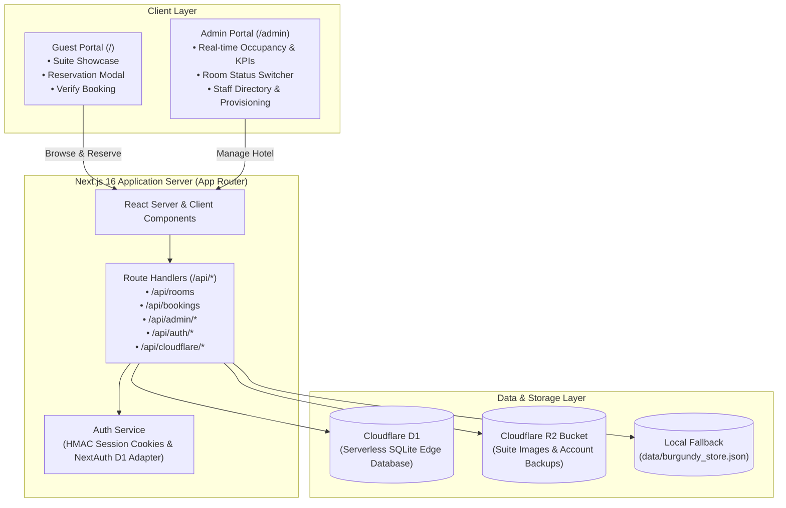
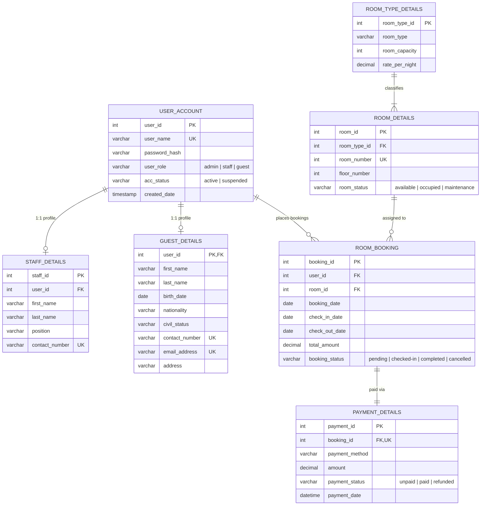

# Burgundy Suite & Resort — System Architecture & Technical Documentation

---

## 1. Executive Summary

**Burgundy Suite & Resort** is an end-to-end luxury hospitality web application and property management system (PMS). It delivers an opulent, responsive guest experience for browsing and reserving high-end suites, paired with a command center for hotel administrators and general managers to monitor real-time occupancy, revenue KPIs, bookings, physical room inventory, and internal staff credentials.

The system is engineered for dual deployment: running locally as a full-stack Next.js 16 application backed by a persistent file store, and natively on Cloudflare’s Edge Infrastructure leveraging **Cloudflare D1 (Serverless SQLite)** and **Cloudflare R2 (Object Storage)**.

---

## 2. Technology Stack

| Layer | Technology | Description |
| :--- | :--- | :--- |
| **Framework** | **Next.js 16 (App Router)** | Modern React framework utilizing Turbopack, Server Components, and API Route Handlers. |
| **Language** | **TypeScript** | Strict type definitions across frontend components, API payloads, and database models. |
| **Styling** | **Tailwind CSS & CSS Modules** | Custom luxury palette: Deep Burgundy (`#2B0E14`), Rich Wine (`#381018`), Warm Gold (`#E5C378`), and Cream Ivory (`#F5EFEB`). |
| **Database** | **Cloudflare D1 / SQLite** | Relational SQL database strictly modeled according to a 7-table ERD specification. |
| **Object Storage** | **Cloudflare R2 (AWS S3-compatible)** | Zero-egress bucket storage for suite photography and executive account backups. |
| **Authentication** | **Auth.js (NextAuth) + Custom HMAC Cookies** | Hybrid security utilizing HTTP-only signed session cookies with optional Cloudflare Zero Trust / Turnstile support. |
| **Icons & UI** | **Lucide React** | Featherweight SVG icons for hotel amenity badges, management KPIs, and navigation. |

---

## 3. High-Level System Architecture



---

## 4. Database Schema (7-Table ERD Design)

The database schema strictly adheres to relational normalization standards and is declared in [migrations/0001_initial_schema.sql](file:///c:/Users/Ian/OneDrive/Desktop/cha/burgundysuite/migrations/0001_initial_schema.sql) and [src/types/database.ts](file:///c:/Users/Ian/OneDrive/Desktop/cha/burgundysuite/src/types/database.ts):



### Realistic Room Inventory Mapping
The resort features **8 Curated Suite Types** mapped 1-to-1 to physical rooms across 5 floors:
- **Floor 1**: Room 101 (Deluxe Suite, Occupied), Room 102 (Executive King, Available)
- **Floor 2**: Room 201 (Presidential Suite, Occupied), Room 202 (Oceanview Sunset Villa, Maintenance)
- **Floor 3**: Room 301 (Family Suite, Available), Room 302 (Sapphire Ocean Villa, Available)
- **Floor 4**: Room 401 (Penthouse Haven, Occupied)
- **Floor 5**: Room 501 (Royal Emerald Penthouse, Available)

---

## 5. Frontend Architecture & Components

The frontend is housed in [src/components/](file:///c:/Users/Ian/OneDrive/Desktop/cha/burgundysuite/src/components/) and organized into two primary user surfaces:

### A. Guest Portal (`/`)
1. **[Hero.tsx](file:///c:/Users/Ian/OneDrive/Desktop/cha/burgundysuite/src/components/Hero.tsx)**:
   - High-impact visual header with responsive branding, tagline, quick reservation button, and anchor navigation.
2. **[Navbar.tsx](file:///c:/Users/Ian/OneDrive/Desktop/cha/burgundysuite/src/components/Navbar.tsx)**:
   - Floating header with smooth scroll links (`#haven`, `#suites`, `#amenities`), mobile drawer hamburger menu, and "Verify Booking" modal trigger.
3. **[SuitesSection.tsx](file:///c:/Users/Ian/OneDrive/Desktop/cha/burgundysuite/src/components/SuitesSection.tsx)**:
   - Interactive catalog displaying the 8 luxury suite tiers.
   - Shows guest capacity badges, high-resolution imagery, feature tags, starting nightly rate, and a "Book Suite" trigger. Includes multi-page pagination.
4. **[ReservationModal.tsx](file:///c:/Users/Ian/OneDrive/Desktop/cha/burgundysuite/src/components/ReservationModal.tsx)**:
   - Multi-step booking experience with automatic night calculation, guest details inputs, date validation, and payment option selection:
     - **E-Wallet** (GCash, Maya, GrabPay)
     - **Pay at Counter** (Front desk settlement upon check-in)
5. **[VerifyBookingModal.tsx](file:///c:/Users/Ian/OneDrive/Desktop/cha/burgundysuite/src/components/VerifyBookingModal.tsx)**:
   - Passwordless verification system allowing guests to input their email and view active stay dates, room number, and booking confirmation without needing an account password.
6. **[HavenOverview.tsx](file:///c:/Users/Ian/OneDrive/Desktop/cha/burgundysuite/src/components/HavenOverview.tsx)** & **[AmenitiesSection.tsx](file:///c:/Users/Ian/OneDrive/Desktop/cha/burgundysuite/src/components/AmenitiesSection.tsx)**:
   - Rich brand storytelling highlighting private plunge pools, helicopter transfers, Michelin-star dining, and spa treatments.

---

### B. Admin Command Center (`/admin`)
1. **[AdminLoginGate.tsx](file:///c:/Users/Ian/OneDrive/Desktop/cha/burgundysuite/src/components/admin/AdminLoginGate.tsx)**:
   - Clean, security-focused authentication view for managers and staff. Does not leak test credentials; directly authenticates against the database.
2. **[AdminHeader.tsx](file:///c:/Users/Ian/OneDrive/Desktop/cha/burgundysuite/src/components/admin/AdminHeader.tsx)**:
   - Management toolbar showing logged-in user profile, role badge, quick actions (`+ Add Suite`, `Accounts`, `Export Report`, `Cloudflare D1 Status`, and `Logout`).
3. **[AdminKPIs.tsx](file:///c:/Users/Ian/OneDrive/Desktop/cha/burgundysuite/src/components/admin/AdminKPIs.tsx)**:
   - Executive dashboard reporting Total Revenue (₱), Occupancy Rate (%), Pending Checkouts Today, Average Stay Duration, and a dynamic 7-day occupancy trend chart.
4. **[RoomInventoryGrid.tsx](file:///c:/Users/Ian/OneDrive/Desktop/cha/burgundysuite/src/components/admin/RoomInventoryGrid.tsx)**:
   - Real-time room cards grouped by floor.
   - Allows instant inline status changes (`Available`, `Occupied`, `Maintenance`) that persist to the database and update occupancy KPIs in real time.
5. **[BookingsTable.tsx](file:///c:/Users/Ian/OneDrive/Desktop/cha/burgundysuite/src/components/admin/BookingsTable.tsx)** & **[PaymentLogs.tsx](file:///c:/Users/Ian/OneDrive/Desktop/cha/burgundysuite/src/components/admin/PaymentLogs.tsx)**:
   - Searchable, filterable ledger of hotel reservations and audited financial transactions.
6. **[StaffAccountsModal.tsx](file:///c:/Users/Ian/OneDrive/Desktop/cha/burgundysuite/src/components/admin/StaffAccountsModal.tsx)**:
   - Full CRUD staff directory allowing General Managers to provision, update, and remove internal staff accounts with self-deletion guards.
7. **[AddSuiteModal.tsx](file:///c:/Users/Ian/OneDrive/Desktop/cha/burgundysuite/src/components/admin/AddSuiteModal.tsx)**:
   - Modal for adding new accommodations. Supports drag-and-drop image uploads directly into Cloudflare R2 and collision-free room number assignment.
8. **[CloudflareD1Modal.tsx](file:///c:/Users/Ian/OneDrive/Desktop/cha/burgundysuite/src/components/admin/CloudflareD1Modal.tsx)**:
   - Live telemetry inspector for Cloudflare D1 edge database connectivity, credentials verification, and 1-click database synchronization.

---

## 6. Backend & API Route Handlers

All endpoints reside in [src/app/api/](file:///c:/Users/Ian/OneDrive/Desktop/cha/burgundysuite/src/app/api/) following standard Next.js Route Handler conventions:

| Route Path | HTTP Methods | Description |
| :--- | :--- | :--- |
| `/api/auth/login` | `POST` | Authenticates management credentials against Cloudflare D1/local database; sets signed HTTP-only cookie. |
| `/api/auth/logout` | `POST` | Invalidates active management cookie session. |
| `/api/auth/me` | `GET` | Validates session token and returns active manager details. |
| `/api/rooms` | `GET` | Returns all physical rooms with joined suite categories and live statuses. |
| `/api/rooms/status` | `PUT` | Toggles room status between `available`, `occupied`, and `maintenance`. |
| `/api/rooms/create` | `POST` | Provisions a new suite category, uploads media to R2, and registers physical room. |
| `/api/bookings` | `GET`, `POST` | Retrieves reservation rosters or creates new guest booking with associated payment record. |
| `/api/bookings/verify` | `POST` | Allows guests to retrieve stay records via email without an account password. |
| `/api/admin/metrics` | `GET` | Computes revenue aggregates, occupancy percentage, and weekly trend graphs. |
| `/api/admin/accounts` | `GET`, `POST`, `PUT`, `DELETE` | Full management CRUD for internal staff and executive profiles. |
| `/api/cloudflare` | `GET` | Inspects connection status, account ID, and database table row counts. |
| `/api/cloudflare/sync` | `POST` | Executes `0001_initial_schema.sql` and `seed.sql` on the live Cloudflare D1 instance. |
| `/api/media/suites/[filename]` | `GET` | Fallback stream handler for locally saved suite media assets. |

---

## 7. Storage & Cloudflare Edge Services

### Cloudflare D1 (Database)
- Configured via `CLOUDFLARE_ACCOUNT_ID`, `CLOUDFLARE_DATABASE_ID`, and `CLOUDFLARE_API_TOKEN`.
- Client logic in [src/lib/cloudflare-d1.ts](file:///c:/Users/Ian/OneDrive/Desktop/cha/burgundysuite/src/lib/cloudflare-d1.ts).
- Automatically executes batched parameterized SQL queries against Cloudflare's global edge network.

### Cloudflare R2 (Object Storage)
- Configured via S3-compatible credentials in [src/lib/cloudflare-r2.ts](file:///c:/Users/Ian/OneDrive/Desktop/cha/burgundysuite/src/lib/cloudflare-r2.ts).
- Used for saving suite photographs uploaded via the admin portal and automated JSON account backup archives.

### Local JSON Store (`data/burgundy_store.json`)
- Acts as a local zero-config database during development or offline testing.
- Database abstraction in [src/lib/db.ts](file:///c:/Users/Ian/OneDrive/Desktop/cha/burgundysuite/src/lib/db.ts) transparently reads from and writes to this store if external Cloudflare services are unreachable.

---

## 8. Security & Authentication Architecture

1. **Passwordless Guest Experience:**
   - Guests do not have passwords. Reservations are linked to their email, and verification is performed via secure email + booking reference lookup.
2. **Administrative Sessions:**
   - Management sessions use HMAC-SHA256 signed tokens stored inside HTTP-only, `sameSite: 'lax'` cookies ([src/lib/auth.ts](file:///c:/Users/Ian/OneDrive/Desktop/cha/burgundysuite/src/lib/auth.ts)).
3. **Role-Based Authorization:**
   - Management users logged into `/admin` possess unified administrative authorization to oversee operations, change room statuses, and update staff records.
   - Self-deletion protection prevents administrators from accidentally deleting their own currently active account.
4. **Cloudflare Zero Trust / Access Support:**
   - Headers (`cf-access-authenticated-user-email` and `cf-access-jwt-assertion`) are parsed in [src/lib/cloudflare-auth.ts](file:///c:/Users/Ian/OneDrive/Desktop/cha/burgundysuite/src/lib/cloudflare-auth.ts) to support enterprise SSO when deployed behind Cloudflare Access.

---

## 9. Running and Deploying

### Prerequisites
- Node.js 18+ (tested on Node.js v24)
- npm or yarn

### Setup Instructions
1. **Install Dependencies:**
   ```bash
   npm install
   ```
2. **Environment Configuration:**
   Copy `.env.example` to `.env.local` and configure your credentials:
   ```bash
   cp .env.example .env.local
   ```
3. **Start Development Server:**
   ```bash
   npm run dev
   ```
   Open [http://localhost:3000](http://localhost:3000) for the guest portal and [http://localhost:3000/admin](http://localhost:3000/admin) for the admin portal.

4. **Sync Cloudflare D1 Database:**
   Log into the admin portal, open the **Cloudflare D1** modal, and click **"1-Click Initialize & Sync D1"** (or send `POST /api/cloudflare/sync`).
