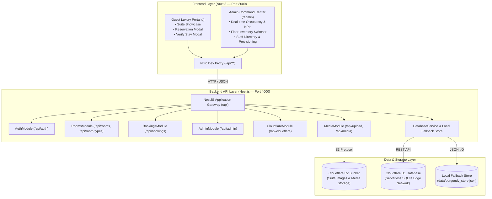
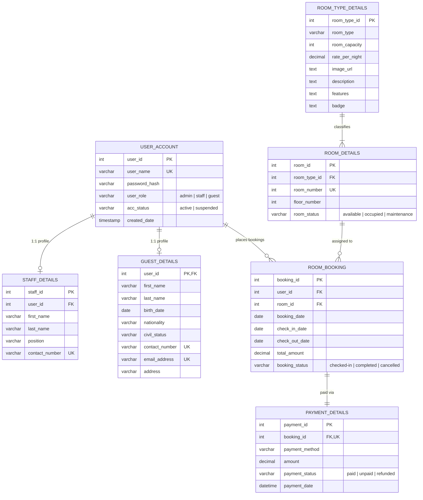

# Burgundy Suite & Resort — System Architecture & Technical Documentation

---

## 1. Executive Summary

**Burgundy Suite & Resort** is an end-to-end luxury hospitality web application and property management system (PMS). It delivers an opulent, responsive guest experience for browsing and reserving high-end suites, paired with a command center for hotel administrators and general managers to monitor real-time occupancy, revenue KPIs, bookings, physical room inventory, and internal staff credentials.

The system is engineered as a decoupled modern **Monorepo**:
1. **Frontend**: **Nuxt 3 (Vue 3 Single File Components)** powered by Vite, Tailwind CSS, Lucide icons, and Vue Composables (`localhost:3000`).
2. **Backend**: **Nest.js** enterprise REST API (`localhost:4000/api`) structured with modular TypeScript architecture, dependency injection, controllers, guards, and services.
3. **Database & Storage**: Dual-mode storage featuring live edge **Cloudflare D1 (Serverless SQLite)** via REST API, **Cloudflare R2 (Object Storage)** via S3 protocol, and a zero-config local JSON persistence store fallback (`data/burgundy_store.json`).

---

## 2. Technology Stack

| Layer | Technology | Description |
| :--- | :--- | :--- |
| **Frontend Framework** | **Nuxt 3 (Vue 3)** | High-performance Vue framework with Vite, reactive state composables (`useAuth`, `useApi`), and SSR/SPA capabilities. |
| **Backend Framework** | **Nest.js 10** | Enterprise Node.js framework with modular architecture (`AuthModule`, `RoomsModule`, `BookingsModule`, `AdminModule`, `CloudflareModule`, `MediaModule`). |
| **Language** | **TypeScript 5** | Strict type definitions across frontend Vue components, Nest DTOs, controllers, and database models. |
| **Styling** | **Tailwind CSS v4 & Custom Tokens** | Curated luxury palette: Deep Burgundy (`#2B0E14`), Rich Wine (`#381018`), Warm Gold (`#E5C378`), and Cream Ivory (`#F5EFEB`). |
| **Database** | **Cloudflare D1 / SQLite** | Relational SQL database strictly modeled according to a 7-table ERD specification with live REST execution & batching. |
| **Object Storage** | **Cloudflare R2 (S3-compatible)** | Zero-egress bucket storage for suite photography and account backups via `@aws-sdk/client-s3`. |
| **Authentication** | **HMAC Signed HTTP-Only Cookies** | Session security utilizing cryptographic HMAC tokens stored in HTTP-only cookies with Cloudflare Zero Trust / Turnstile support. |
| **Icons & UI** | **Lucide Vue Next** | Lightweight SVG icons for hotel amenity badges, management KPIs, and navigation. |

---

## 3. High-Level Monorepo Architecture



---

## 4. Repository Structure

```
burgundysuite/
├── backend/                       # Nest.js Backend Service (Port 4000)
│   ├── src/
│   │   ├── database/
│   │   │   ├── database.module.ts
│   │   │   └── database.service.ts # 7-table DBMS logic, D1 queries & local store
│   │   ├── modules/
│   │   │   ├── auth/              # HMAC sessions, login, logout, me, Turnstile
│   │   │   ├── rooms/             # Rooms and room-types controllers
│   │   │   ├── bookings/          # Reservations, guest records, checkouts
│   │   │   ├── admin/             # KPIs, staff CRUD, payments, reset
│   │   │   ├── cloudflare/        # D1 query execution, telemetry & sync
│   │   │   └── media/             # Cloudflare R2 upload & media stream proxy
│   │   ├── types/
│   │   │   └── database.ts        # Shared ERD types and interfaces
│   │   ├── app.module.ts          # Root Nest module
│   │   └── main.ts                # Bootstrap, CORS, CookieParser, global prefix
│   ├── package.json
│   └── tsconfig.json
├── frontend/                      # Nuxt 3 Frontend Application (Port 3000)
│   ├── assets/
│   │   └── css/main.css           # Luxury burgundy theme tokens & styles
│   ├── components/
│   │   ├── Navbar.vue             # Header with smooth navigation & guest verification trigger
│   │   ├── Hero.vue               # Visual banner with availability datepicker
│   │   ├── HavenOverview.vue      # Storytelling & bento masonry showcase
│   │   ├── SuitesSection.vue      # 8 luxury suites with pagination & reservation trigger
│   │   ├── ReservationModal.vue   # Multi-step booking modal with instant calculations
│   │   ├── VerifyBookingModal.vue # Passwordless guest email stay lookup
│   │   ├── AmenitiesSection.vue   # World-class amenities cards & perks
│   │   ├── Footer.vue             # Opulent footer with concierge details
│   │   └── admin/
│   │       ├── AdminLoginGate.vue # Credentials gate for management staff
│   │       ├── AdminHeader.vue    # Toolbar with quick actions & user session
│   │       ├── AdminHeroBanner.vue# Executive hero banner with scroll cue
│   │       ├── AdminKPIs.vue      # Revenue, Occupancy %, and Checkout counters
│   │       ├── AdminChart.vue     # Dynamic 7-day revenue performance chart
│   │       ├── RoomInventoryGrid.vue # Floor cards with live status switcher
│   │       ├── BookingsTable.vue  # Filterable booking ledger & 1-click checkout
│   │       ├── PaymentLogs.vue    # Financial audit trail
│   │       ├── StaffAccountsModal.vue # Staff directory & account provisioning
│   │       ├── AddSuiteModal.vue  # R2 drag-and-drop upload & suite creator
│   │       ├── CloudflareD1Modal.vue  # Live D1 connectivity & 1-click sync
│   │       └── ConfirmModal.vue   # Accessible confirmation dialog
│   ├── composables/
│   │   ├── useApi.ts              # Authenticated fetch client with cookies
│   │   └── useAuth.ts             # Reactive admin session management
│   ├── pages/
│   │   ├── index.vue              # Guest Luxury Portal
│   │   └── admin/index.vue        # Executive Management Command Center
│   ├── app.vue                    # Root Nuxt layout
│   ├── nuxt.config.ts             # Tailwind v4, nitro proxy to Nest backend
│   └── package.json
├── migrations/                    # Database DDL & Seed
│   ├── 0001_initial_schema.sql
│   └── seed.sql
├── data/
│   └── burgundy_store.json        # Zero-config local persistence fallback
├── package.json                   # Root monorepo workspace orchestration
└── wrangler.json                  # Cloudflare D1 database configuration
```

---

## 5. Database Schema (7-Table ERD Design)



---

## 6. Nest.js Backend API Endpoints

All endpoints are hosted under `http://localhost:4000/api` (and proxied automatically from Nuxt at `/api/*`):

| Controller | Method | Path | Description |
| :--- | :--- | :--- | :--- |
| **AuthController** | `POST` | `/api/auth/login` | Authenticates admin/staff against D1/store; sets HTTP-only session cookie. |
| **AuthController** | `POST` | `/api/auth/logout` | Clears management session cookie. |
| **AuthController** | `GET` | `/api/auth/me` | Validates active session token or Cloudflare Zero Trust headers. |
| **RoomsController** | `GET` | `/api/rooms` | Returns physical rooms with joined category data and statuses. |
| **RoomsController** | `PATCH` | `/api/rooms` | Updates room status (`available`, `occupied`, `maintenance`). |
| **RoomsController** | `GET` | `/api/room-types` | Returns all curated suite tiers. |
| **RoomsController** | `POST` | `/api/room-types` | Creates a new suite category and registers a physical room. |
| **BookingsController** | `GET` | `/api/bookings` | Returns booking roster (supports `?filter=` and `?email=`). |
| **BookingsController** | `POST` | `/api/bookings` | Creates a reservation, guest record, and payment transaction. |
| **BookingsController** | `POST` | `/api/bookings/:id/checkout` | Completes guest stay and resets room status to available. |
| **AdminController** | `GET` | `/api/admin/metrics` | Calculates revenue aggregates, occupancy %, and 7-day trend chart. |
| **AdminController** | `GET` | `/api/admin/accounts` | Returns staff and executive profiles (admin session required). |
| **AdminController** | `POST` | `/api/admin/accounts` | Provisions a new staff or admin user account. |
| **AdminController** | `PUT` | `/api/admin/accounts` | Updates existing staff profile. |
| **AdminController** | `DELETE`| `/api/admin/accounts?id=`| Removes staff account with self-deletion protection. |
| **AdminController** | `POST` | `/api/admin/reset` | Resets local store to seed state. |
| **AdminController** | `POST` | `/api/admin/simulate-checkout` | Simulates departure checkouts for stays ending today. |
| **AdminController** | `GET` | `/api/payments` | Returns transaction logs from `PAYMENT_DETAILS`. |
| **CloudflareController** | `GET` | `/api/cloudflare` | Live telemetry probe for D1 database and R2 bucket connectivity. |
| **CloudflareController** | `POST` | `/api/cloudflare` | Saves D1/R2 configuration or triggers 1-click sync. |
| **CloudflareController** | `POST` | `/api/cloudflare/sync` | Executes `migrations/0001_initial_schema.sql` and `migrations/seed.sql` on D1. |
| **MediaController** | `POST` | `/api/upload` | Multipart image upload to Cloudflare R2 with local mirror caching. |
| **MediaController** | `GET` | `/api/media/*` | Serves media assets from Cloudflare R2 or local cache. |

---

## 7. Running the Application

### 1. Start Both Services Concurrently
From the root directory:
```bash
npm run dev
```
- **Nuxt 3 Frontend**: [http://localhost:3000](http://localhost:3000)
- **Nest.js API**: [http://localhost:4000/api](http://localhost:4000/api)

### 2. Run Independently
To run either service in its own terminal:
```bash
# Terminal 1: Nest.js Backend
npm run dev:backend

# Terminal 2: Nuxt 3 Frontend
npm run dev:frontend
```

### 3. Production Build
```bash
npm run build
```
This builds both the NestJS server (`backend/dist`) and the Nuxt 3 production bundle (`frontend/.output`).

### 4. Cloudflare D1 Management Commands
```bash
# Execute initial schema migration remotely on Cloudflare D1
npm run d1:migrate

# Seed remote Cloudflare D1 database
npm run d1:seed
```
